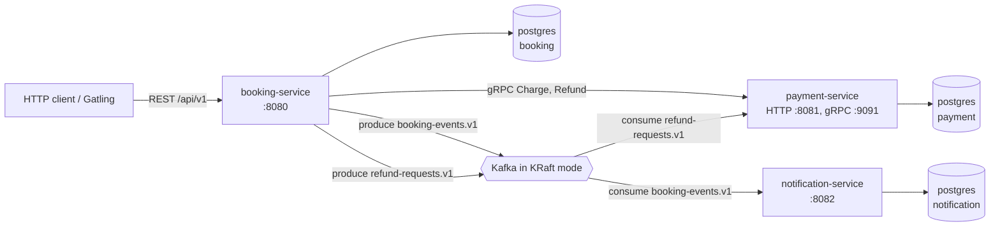
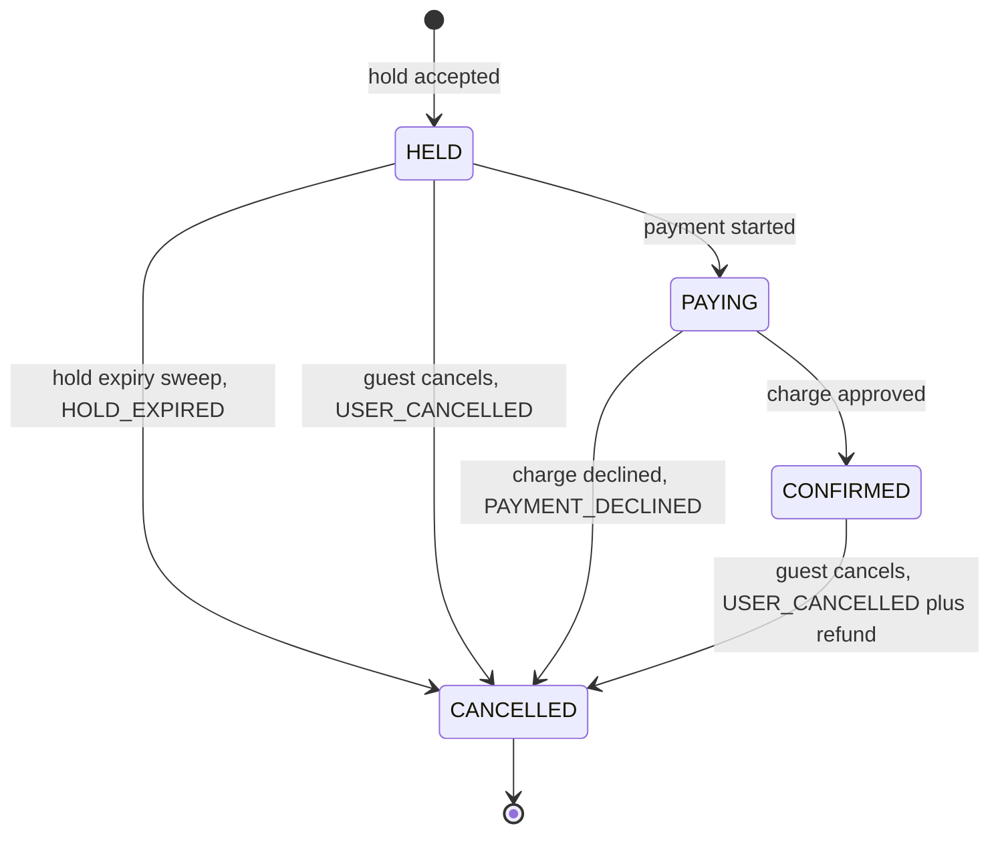
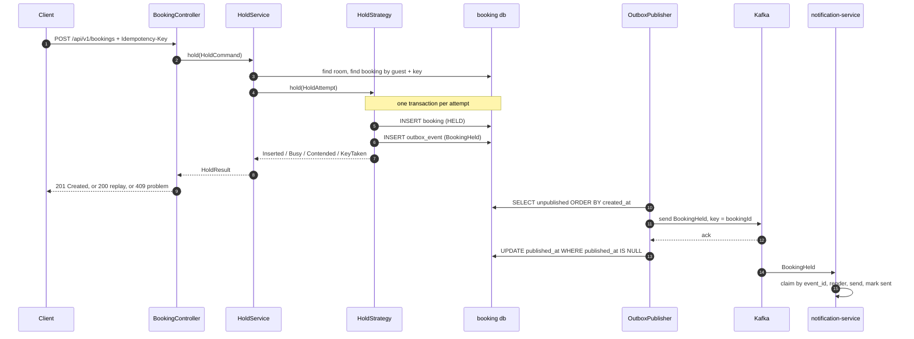
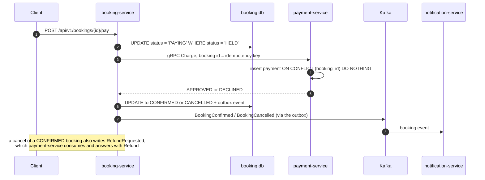

# Architecture

RoomLock is a hotel room booking backend built to make concurrency control visible. The interesting
part is not the domain — a guest holds a room for a stay, pays, and gets a confirmation — but that
the same use case is implemented behind three interchangeable locking strategies, that the database
guard behind them can be switched off to prove the application-level ones, and that everything which
leaves a service boundary does so through a transactional outbox and is consumed idempotently.

Companion documents: [locking strategies](locking-strategies.md) and
[reliability guarantees](reliability.md).

## Modules

`settings.gradle.kts` includes six projects plus the included build `build-logic`, which holds the
convention plugins. Every version is pinned in `gradle/libs.versions.toml` (rule ST-3).

| Module | Convention plugin | What it is |
| --- | --- | --- |
| `booking-service` | `roomlock.spring-boot-service` | Catalog, holds, booking lifecycle, outbox. The only module with an HTTP API a client uses. |
| `payment-service` | `roomlock.spring-boot-service` | Idempotent `Charge` and `Refund` over gRPC, plus a consumer of `RefundRequested`. |
| `notification-service` | `roomlock.spring-boot-service` | Consumes booking events and records one delivery per event. |
| `payment-api` | `roomlock.proto-contract` | Only `payment-api/src/main/proto/payment.proto` and the code protoc generates from it. |
| `common` | `roomlock.java-conventions` | The Kafka contract: `dev.roomlock.contract.v1` records and `Topics`. No Spring dependency beyond `spring-core` for `@Nullable` (rule ST-8). |
| `load-tests` | `roomlock.load-tests` | Gatling Java DSL scenarios; `gatlingRun` is deliberately not wired into `build` (rule Q-1). |

`roomlock.java-base` sets the Java 21 toolchain, Spotless with google-java-format, the JUnit
Platform and JaCoCo. `roomlock.java-conventions` adds `-Werror` for hand-written code (rule Q-3);
`payment-api` stays on `java-base` because generated code cannot be held to it.
`roomlock.spring-boot-service` adds actuator, the Prometheus registry and a Jib image
`roomlock/<module>:dev`.

## Components and channels



Only two kinds of edge leave a service: one synchronous gRPC call from booking-service to
payment-service, and Kafka records produced by booking-service and consumed by the other two. No
service reads another service's database; each owns exactly one.

The gRPC edge is the only place where a booking waits for another service. Everything else is
asynchronous, which is why the outbox exists (see [reliability](reliability.md)).

Observability is scraped, not pushed: `infra/prometheus.yml` scrapes `/actuator/prometheus` on
`booking-service:8080`, `payment-service:8081` and `notification-service:8082` every 5s and labels
each target with `service`; Grafana is provisioned from `infra/grafana/provisioning` and loads the
dashboard in `infra/grafana/dashboards/roomlock.json`. `infra/prometheus-ide.yml` is the same list
against `host.docker.internal` for the IDE override.

## Data ownership

One PostgreSQL 16 instance, three databases created once by `infra/postgres/init/01-create-databases.sh`.
Every service runs Flyway against its own database and Hibernate with `ddl-auto: validate`, so the
migrations are the schema of record and the entities are validated against them at startup.

| Service | Database | Tables | Migrations |
| --- | --- | --- | --- |
| booking-service | `booking` | `hotel`, `room`, `booking`, `outbox_event` | `db/migration/V1,V2,V3,V5` plus `db/constraint/V4` |
| payment-service | `payment` | `payment` | `payment-service/src/main/resources/db/migration/V1__create_payment.sql` |
| notification-service | `notification` | `notification` | `notification-service/src/main/resources/db/migration/V1__create_notification.sql` |

booking-service is the only service with two Flyway locations:
`spring.flyway.locations: classpath:db/migration, classpath:db/constraint`. The `no-constraint`
profile drops the second one, which is the whole point of decision D1 — see
[locking strategies](locking-strategies.md#the-no-constraint-profile).

The interesting columns and constraints of `booking`
(`booking-service/src/main/resources/db/migration/V2__create_booking.sql`):

| Object | Purpose |
| --- | --- |
| `stay daterange GENERATED ALWAYS AS ... STORED` | Half-open `[check_in, check_out)`, decision D5. The generating expression is wrapped in a `CASE` so a reversed pair does not fail inside `daterange()` with SQLSTATE 22000 before `booking_dates_valid` reports it as 23514. |
| `booking_dates_valid` | `check_out > check_in`. |
| `booking_status_valid` | `status IN ('HELD','PAYING','CONFIRMED','CANCELLED')`. |
| `booking_cancel_reason_valid` | `cancel_reason IN ('PAYMENT_DECLINED','HOLD_EXPIRED','USER_CANCELLED')`. |
| `booking_cancel_reason_consistent` | `(status = 'CANCELLED') = (cancel_reason IS NOT NULL)` — a cancelled booking always has a reason and no other status ever has one. |
| `booking_guest_id_idempotency_key_key` | `UNIQUE (guest_id, idempotency_key)` — the idempotency guarantee of a hold, rule I-1. |
| `booking_no_overlap` (V4, constraint location) | `EXCLUDE USING gist (room_id WITH =, stay WITH &&) WHERE (status IN ('HELD','PAYING','CONFIRMED'))`, on the `btree_gist` extension. |
| `booking_status_hold_expires_at_idx` | Drives the hold expiry sweep. |
| `booking_status_payment_started_at_idx` | Exists for the PAYING sweep of the payment flow; nothing in this branch reads it yet. |

`room.version` is a plain `bigint` column, not a JPA `@Version`: rule DB-8 says it is written by one
explicit native `UPDATE` and never through the entity
(`booking-service/src/main/java/dev/roomlock/booking/domain/Room.java`,
`RoomRepository.bumpVersion`).

## The rule that shapes every write: conditional native UPDATE

Rule DB-5: **no status ever changes through a JPA entity.** Every transition is a native `UPDATE`
whose `WHERE` clause repeats the status the transition is allowed to start from, and the affected row
count is the answer.

```java
// BookingRepository.cancelHeld
UPDATE booking
SET status = 'CANCELLED', cancel_reason = 'USER_CANCELLED', updated_at = ...
WHERE id = :id AND status = 'HELD'
```

The reason is that a read-then-write cannot be made safe without a lock, while a conditional update
is atomic by construction. `LifecycleService.cancel` uses exactly that: if the statement affected a
row, this call performed the transition; if it affected none, the row is read back and its current
status says which outcome it is — `AlreadyCancelled` for `CANCELLED`, `NotCancellable` for
`CONFIRMED` (and for `PAYING`). A `HELD` row cannot reach that branch, because the `UPDATE` would
have waited for the concurrent writer and then matched; the code says so in a comment.

The same shape appears everywhere a race is possible, and always with the affected-row count as the
decision:

| Statement | Condition | 1 means | 0 means |
| --- | --- | --- | --- |
| `BookingRepository.cancelHeld` | `status = 'HELD'` | this call cancelled it | somebody else moved it first |
| `BookingRepository.expireHolds` | `status = 'HELD'` inside a `FOR UPDATE SKIP LOCKED` CTE | the hold expired | a concurrent request had confirmed or cancelled it |
| `RoomRepository.bumpVersion` | `version = :version` | this transaction won the room | it lost the optimistic race |
| `RoomRepository.insertUnlessNumberTaken` | `ON CONFLICT (hotel_id, number) DO NOTHING` | the room was added | the number is taken in that hotel |
| `OutboxEventRepository.markPublished` | `published_at IS NULL` | this publisher marked it | it was published twice |
| `PaymentRepository.insertUnlessBookingCharged` | `ON CONFLICT (booking_id) DO NOTHING` | this call decided the charge | another call decided it first |
| `PaymentRepository.markRefunded` | `status = 'APPROVED'` | this call refunded | nothing to refund |

`expireHolds` is worth reading in full
(`booking-service/src/main/java/dev/roomlock/booking/infra/BookingRepository.java`). It is a CTE
rather than `id IN (SELECT ... LIMIT ...)` because PostgreSQL may plan the subquery as a re-scanned
semi-join and cancel more rows than the batch size; `FOR UPDATE SKIP LOCKED` passes by a row another
transaction is writing instead of waiting, and the next sweep picks it up; and `RETURNING` hands the
cancelled ids back so `LifecycleService` can write one outbox event per booking inside the same
transaction (rule K-1).

## Booking lifecycle



`HELD`, `PAYING` and `CONFIRMED` are the statuses `booking_no_overlap` and
`BookingRepository.existsActiveOverlap` treat as holding the room; `CANCELLED` releases it.
`CONFIRMED` is where a stay that is paid for and not cancelled stays for good, and `CANCELLED` is
absorbing: no statement in the service updates a cancelled row.

| From | To | Reason written | Trigger | Statement | Event |
| --- | --- | --- | --- | --- | --- |
| — | `HELD` | — | `POST /api/v1/bookings` | `INSERT` by the active strategy | `BookingHeld` |
| `HELD` | `CANCELLED` | `HOLD_EXPIRED` | `HoldExpiryScheduler`, every `roomlock.hold.expiry.interval` | `BookingRepository.expireHolds` | `BookingCancelled` |
| `HELD` | `CANCELLED` | `USER_CANCELLED` | `POST /api/v1/bookings/{id}/cancel` | `BookingRepository.cancelHeld` | `BookingCancelled` |
| `HELD` | `PAYING` | — | `POST /api/v1/bookings/{id}/pay` | conditional `UPDATE ... WHERE status = 'HELD'` | none |
| `PAYING` | `CONFIRMED` | — | `Charge` approved | conditional `UPDATE ... WHERE status = 'PAYING'` | `BookingConfirmed` |
| `PAYING` | `CANCELLED` | `PAYMENT_DECLINED` | `Charge` declined | conditional `UPDATE ... WHERE status = 'PAYING'` | `BookingCancelled` |
| `CONFIRMED` | `CANCELLED` | `USER_CANCELLED` | `POST /api/v1/bookings/{id}/cancel` | conditional `UPDATE ... WHERE status = 'CONFIRMED'` | `BookingCancelled` **and** `RefundRequested` |

The last four rows are the payment flow — see [the payment flow in code](#the-payment-flow-in-code).
`LifecycleService.cancel` still answers 409 `booking-not-cancellable` for a `PAYING` booking, because
a charge is in flight and nothing may cancel a stay whose money is in the air.

The three cancel reasons are `dev.roomlock.booking.domain.CancelReason`; they are mirrored
name-for-name by `dev.roomlock.contract.v1.CancellationReason` (decision D3), and
`BookingEvents.reasonOf` converts between them with `valueOf`, so a renamed constant breaks at
runtime in one place rather than silently producing a wrong event.

## A hold, end to end



`HoldService.hold` is deliberately **not** `@Transactional`: the write belongs to the strategy, which
opens a transaction per attempt through `TransactionalHoldStrategy` so a lost attempt is rolled back
before the next one starts and a constraint violation is translated after the rollback rather than
inside the broken transaction. The controller maps outcomes to statuses and nothing else (rule A-2):

| `HoldResult` | HTTP |
| --- | --- |
| `Held` | 201 with `Location` |
| `AlreadyHeld` | 200 with the first booking |
| `RoomBusy` | 409 `urn:roomlock:problem:room-busy` |
| `RoomContended` | 409 `urn:roomlock:problem:room-contended` |
| `IdempotencyKeyReused` | 409 `urn:roomlock:problem:idempotency-key-reused` |

Every error response is a `ProblemDetail` built by
`booking-service/src/main/java/dev/roomlock/booking/api/Problems.java`, the single factory (rules
E-1, E-2), and `ApiExceptionHandler` is the only place that turns an exception into a response.
`ResourceNotFoundException` is 404 `not-found` with `resource` and `id` (rule E-4); an unknown room
is therefore not a business outcome of a hold. `internalError()` deliberately tells the client
nothing about the cause (rule E-2). Validation lives in the request records and in the `@StayDates`
class-level constraint, which reports the violation on `checkOut` — the field a client can fix — so
`DateRange` never sees an invalid pair (rule V-4).

## The payment path



The classes behind each step are listed below.

## The payment flow in code

| Step | Where it lives |
| --- | --- |
| `POST /api/v1/bookings/{id}/pay` | `booking-service/src/main/java/dev/roomlock/booking/api/BookingController.java`, answering `PayResult` |
| the use case, and the outcome the API maps | `booking-service/src/main/java/dev/roomlock/booking/payment/PaymentService.java`, `.../payment/PayResult.java` |
| the three transitions, each a conditional UPDATE | `booking-service/src/main/java/dev/roomlock/booking/payment/PaymentTransitions.java` over `BookingRepository.startPaying` / `confirmPaying` / `declinePaying` |
| the charge as a port, so the flow can be driven without a provider | `booking-service/src/main/java/dev/roomlock/booking/payment/PaymentGateway.java`, `.../payment/ChargeOutcome.java` |
| the gRPC adapter, with a deadline on every call | `booking-service/src/main/java/dev/roomlock/booking/payment/GrpcPaymentGateway.java`, `.../payment/PaymentChannelConfig.java` |
| the sweep for a booking left in `PAYING` | `booking-service/src/main/java/dev/roomlock/booking/payment/PaymentReconciler.java`, `.../payment/PaymentReconcileScheduler.java` (off under the `test` profile) |
| the events of each ending | `BookingOutbox.recordConfirmed`, `.recordCancelled`, `.recordRefundRequested`, all `MANDATORY` in the transition's transaction |
| the charge itself | `payment-service`, idempotent on the booking id, and its `RefundRequested` consumer |

Two things about it are worth reading the code for. The charge happens **outside** any database
transaction — a network round trip inside one would hold a connection of a pool of ten — so the
transitions before and after it are separate, each conditional on the status it expects. And the
sweep claims its batch as a *lease*: the CTE picks the oldest stale rows `FOR UPDATE SKIP LOCKED` and
re-stamps `payment_started_at`, because the charge runs after that transaction commits and a row lock
would therefore guard nothing between instances. The real guard is that `Charge` is idempotent on the
booking id, so asking again is free.

## Events on the wire

`dev.roomlock.contract.v1.BookingEvent` is a sealed interface over four records, published as JSON.
Two conventions carry the whole contract (`common/src/main/java/dev/roomlock/contract/v1/BookingEvent.java`):

- **`type()` is the simple class name**, and it is the same string the `outbox_event_type_valid`
  CHECK of booking-service allows, so an outbox row and the record it produces can never disagree.
  It travels in the `event-type` Kafka header, not in the body, so a consumer decides how to parse
  before it parses.
- **`bookingId()` is the Kafka key**, so all events of one booking land on one partition and keep
  their order. `eventId()` is unique per published event and is what lets a consumer drop a
  redelivery (rule K-3).

| Topic (`Topics`) | Produced by | Carries | Consumed by |
| --- | --- | --- | --- |
| `roomlock.booking-events.v1` | booking-service outbox | `BookingHeld`, `BookingConfirmed`, `BookingCancelled` | notification-service |
| `roomlock.refund-requests.v1` | booking-service outbox | `RefundRequested` | payment-service |

| Record | Fields beyond `eventId`, `bookingId`, `occurredAt` |
| --- | --- |
| `BookingHeld` | `roomId`, `guestId`, `checkIn`, `checkOut`, `totalPrice`, `currency`, `holdExpiresAt` |
| `BookingConfirmed` | `roomId`, `guestId`, `checkIn`, `checkOut`, `totalPrice`, `currency` |
| `BookingCancelled` | `roomId`, `guestId`, `reason` |
| `RefundRequested` | `guestId`, `totalPrice`, `currency` |

`currency` comes from `roomlock.outbox.currency` (`PLN` by default), not from the booking: the
`booking` table has no currency column, so it belongs to the deployment rather than to a row.

Both consumers park what they cannot handle. `NotificationProperties` and `RefundProperties` carry a
`dead-letter-suffix` of `.DLT`, and both `KafkaConsumerConfig` classes build one
`DefaultErrorHandler` with a `FixedBackOff` of 2 attempts / 1s plus a `DeadLetterPublishingRecoverer`
that writes to `<topic>.DLT` with the partition left to the producer, because the dead-letter topic
may have fewer partitions. `UnreadableEventException` is registered as not retryable: an unknown
`event-type`, a missing header or a payload that does not parse will never succeed, so it is parked
at once instead of being retried.

## What each service owns

### booking-service

The only module with a REST API; OpenAPI at `/v3/api-docs`, Swagger UI at `/swagger-ui.html`
(`booking-service/src/main/java/dev/roomlock/booking/api/OpenApiConfig.java`).

| Package | Responsibility |
| --- | --- |
| `api` | Controllers, request records, `Problems`, `ApiExceptionHandler`, `@StayDates`. HTTP mapping only. |
| `catalog` | `CatalogService`: create a hotel, add a room, read either. |
| `domain` | `Booking`, `Room`, `Hotel`, `OutboxEvent`, `DateRange`, `BookingStatus`, `CancelReason`. Entities hold no transitions. |
| `hold` | `HoldService` and the three strategies behind `HoldStrategy`, plus `HoldMetrics` and `RequestHash`. |
| `lifecycle` | `LifecycleService`: the hold expiry sweep and guest cancellation. |
| `outbox` | `BookingOutbox`, `OutboxWriter`, `OutboxPublisher`, `KafkaEventSender`, `OutboxMetrics`. |
| `infra` | Repositories, `SqlState`, `ClockConfig`, `SchedulingConfig`. |

| Endpoint | Purpose |
| --- | --- |
| `POST /api/v1/hotels`, `GET /api/v1/hotels/{id}` | Hotel catalog |
| `POST /api/v1/hotels/{hotelId}/rooms`, `GET /api/v1/rooms/{id}` | Room catalog; a duplicate number is 409 `room-number-taken` |
| `POST /api/v1/bookings` | Hold a room; `Idempotency-Key` header is required, max 64 characters |
| `POST /api/v1/bookings/{id}/cancel` | Guest cancellation; cancelling twice answers 200 again |
| `GET /api/v1/bookings/{id}` | Read a booking |

Two scheduled sweeps, both disabled under the `test` profile so a test owns the clock and the trigger
(`SchedulingConfig` is `@Profile("!test")`, and so are `HoldExpiryScheduler` and `OutboxScheduler`;
rules SP-9, T-7): the hold expiry sweep every `roomlock.hold.expiry.interval` (30s, batch 500) and
the outbox sweep every `roomlock.outbox.interval` (1s, batch 100).

### payment-service

A stubbed acquirer with real idempotency. `PaymentGrpcEndpoint` serves
`roomlock.payment.v1.PaymentService` from `payment-api` on port 9091, next to the HTTP port, and does
mapping only (rule A-2). `ChargeRule` is deterministic on purpose so a demo or a load test can drive
either path: `roomlock.payment.decision.mode` is `APPROVE_ALL`, `DECLINE_ALL` or `THRESHOLD`, and
`THRESHOLD` declines anything above `decline-above-minor` (100000 minor units, i.e. 1000.00 PLN).

A declined charge is a normal `ChargeResponse` with `DECLINED` and a `decline_reason`, not an error
status. Only two gRPC statuses are ever returned: `INVALID_ARGUMENT` for a request that is not a
request (an id that is not a UUID, a non-positive amount, a currency that is not three letters) and
`FAILED_PRECONDITION` when the same booking id was already charged with a different guest, amount or
currency (rule I-2). Amounts are in minor units end to end, as the proto sends them.

### notification-service

Consumes `roomlock.booking-events.v1` and renders one message per event.
`NotificationMessages.render` switches exhaustively over the sealed `BookingEvent`, so a new event of
the contract cannot be forgotten — the switch stops compiling. `RefundRequested` renders to
`Optional.empty()`: it is addressed to payment-service, and the guest already heard about the
cancellation that caused it. `NotificationSender` is a port; `LoggingNotificationSender` is the only
adapter today, and `NotificationChannel` already names `EMAIL` and `SMS` so a real adapter needs no
schema change.

## Testing strategy

The test support packages are part of the design, not scaffolding.

| Support type | Where | What it does |
| --- | --- | --- |
| `@BookingIntegrationTest` | `booking-service/src/test/java/dev/roomlock/booking/support/BookingIntegrationTest.java` | Full application on a random port against a real PostgreSQL. One annotation per module means one context configuration, hence one cached context and one container. `@AutoConfigureObservability` undoes Boot's test default of disabling metrics export, so the hold meters can be asserted where they are actually scraped. |
| `@BookingJpaTest` | `booking-service/src/test/java/dev/roomlock/booking/support/BookingJpaTest.java` | Repository and schema slice on the real database, `@Transactional(propagation = NOT_SUPPORTED)` so every statement commits. |
| `@PaymentIntegrationTest`, `@NotificationIntegrationTest` | the respective `support` packages | Same idea with a real Kafka as well; the topics and their `.DLT` companions are declared as `NewTopic` beans so `KafkaAdmin` creates them during context refresh, before the listener container starts. |
| `DatabaseCleaner` | each module | Isolation without `@Transactional` (rule T-6): `TRUNCATE` every table but `flyway_schema_history` in `@BeforeEach`. Necessary because listeners and gRPC handlers commit on their own threads. |
| `MutableClock` + `TestClockConfig` | each module | Tests move time forward instead of sleeping (rule T-7). |
| `Concurrently` | booking-service | Runs N calls from N threads released by a `CyclicBarrier`, so a race is a real race (rule T-8). |
| `TestData` | each module | Draft builders with defaults and `with...` modifiers (rule T-9). |
| `BookingTable`, `OutboxTable`, `PaymentTable`, `NotificationTable` | each module | Plain-SQL access, needed precisely because rule DB-5 means a published outbox row or a given status cannot be produced through an entity. |
| `NoTransactions` | booking-service | A transaction manager for scripted strategy attempts that have no resource to enlist. |
| `PaymentGrpcClient` | payment-service | Calls the real server over a real channel rather than in-process, so the transport and generated stubs are covered; the port comes from `local.grpc.port`, published by `spring-grpc-test`. |
| `RecordingNotificationSender` | notification-service | `@Primary` adapter that makes "delivered exactly once" observable without a channel. |
| `BookingEventPublisher`, `RefundRequestPublisher` | consumers | Produce contract records onto the real topic, so a consumer test starts at the broker. |

CI (`.github/workflows/ci.yml`) runs `./gradlew spotlessCheck build` on every pull request and push
to `main` — compilation, formatting check, unit, slice, integration and concurrency tests, with
Testcontainers on the runner's Docker daemon — and uploads the JUnit and JaCoCo reports. Load tests
are a separate manual workflow (`.github/workflows/load-tests.yml`); see
[locking strategies](locking-strategies.md#comparing-them).

## Known gaps

- **`payment-api/src/main/proto/payment.proto` has Russian comments** — the only non-English text in
  the repository.
- **`Profiles.CLOUD` is declared and never used.** `booking-service` and `payment-service` both
  define `cloud`, but no `application.yml` has a `cloud` document and no bean is conditional on it;
  notification-service does not declare it at all.
- **`booking-service/src/main/resources/application.yml` has no `test` profile document**, while
  payment-service and notification-service do. Nothing currently needs one, but the asymmetry is
  worth knowing when adding a test-only override.
- **The compose file has no hook for `roomlock.locking.strategy`.** `README.md` says so and gives the
  workaround (run booking-service next to the infrastructure), but it means the containerised stack
  always runs the `constraint` strategy.
- **notification-service's `notification_event_type_valid` CHECK allows only `BookingHeld`,
  `BookingConfirmed` and `BookingCancelled`**, which is consistent with `RefundRequested` rendering
  to empty, but `BookingEventReader.TYPES` still accepts `RefundRequested` on the booking events
  topic. Nothing produces it there — `KafkaEventSender` routes it to `roomlock.refund-requests.v1` —
  so the leniency is defensive only.
