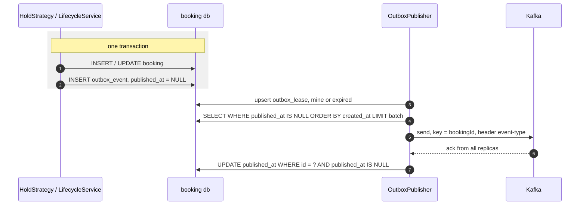

# Reliability

Each mechanism below exists because of one specific failure. The failure is named first; the
mechanism follows. Nothing here needs distributed transactions — every guarantee is a unique
constraint, a conditional `UPDATE`, or a sweep that finishes what a crash interrupted.

Companion documents: [architecture](architecture.md), [locking strategies](locking-strategies.md),
[runbook](runbook.md) for the procedures an on-call person runs against these mechanisms, and
[deployment](deployment.md) for the Google Cloud deployment
[one section below](#what-changes-in-the-cloud) summarises.

| Failure | Defence | Where |
| --- | --- | --- |
| A client retries a hold it never got an answer to, and gets a second booking | hold idempotency on `(guest_id, idempotency_key)` plus a stored request hash | `booking-service/src/main/java/dev/roomlock/booking/hold/HoldService.java`, `booking-service/src/main/resources/db/migration/V2__create_booking.sql` |
| A client reuses one key for a different request | the request hash refuses it with 409 instead of replaying a wrong answer | `booking-service/src/main/java/dev/roomlock/booking/hold/RequestHash.java` |
| The booking commits and the event is lost, or the event goes out and the booking rolls back | transactional outbox: the event is written in the booking's transaction | `booking-service/src/main/java/dev/roomlock/booking/outbox/OutboxWriter.java`, `booking-service/src/main/resources/db/migration/V3__create_outbox_event.sql` |
| The process dies between publishing an event and marking it published | send first, mark second — the event is sent again rather than lost | `booking-service/src/main/java/dev/roomlock/booking/outbox/OutboxPublisher.java` |
| Two booking-service instances sweep the outbox at once and publish one booking's events out of order | the publisher lease: a conditional upsert of a single row, so one instance sweeps and an unrenewed lease is taken over | `booking-service/src/main/java/dev/roomlock/booking/infra/PublisherLease.java`, `booking-service/src/main/resources/db/migration/V6__create_outbox_lease.sql` |
| `outbox_event` grows for as long as the service runs | published events older than `roomlock.outbox.retention.older-than` are deleted in bounded batches, on a trigger of their own | `OutboxEventRepository.deletePublishedBefore`, `booking-service/src/main/java/dev/roomlock/booking/outbox/OutboxProperties.java` |
| Kafka redelivers an event and the guest is told twice | `notification.event_id` unique, claimed before the send | `notification-service/src/main/java/dev/roomlock/notification/notify/NotificationService.java`, `notification-service/src/main/resources/db/migration/V1__create_notification.sql` |
| Kafka redelivers a refund, or the booking service retries `Charge`, and the guest is charged twice | booking id is the idempotency key of both `Charge` and `Refund` | `payment-service/src/main/java/dev/roomlock/payment/payments/PaymentService.java`, `payment-service/src/main/resources/db/migration/V1__create_payment.sql` |
| A hold is abandoned and its room is blocked forever | the hold expiry sweep | `booking-service/src/main/java/dev/roomlock/booking/lifecycle/LifecycleService.java` |
| A `PAYING` booking is left behind by a call that never came back | the reconciliation sweep asks `Charge` again, which is idempotent on the booking id | `booking-service/src/main/java/dev/roomlock/booking/payment/PaymentReconciler.java` |
| A record the consumer can never handle blocks its partition | retry with backoff, then the dead-letter topic; unreadable records skip the retries | `payment-service/src/main/java/dev/roomlock/payment/infra/KafkaConsumerConfig.java`, `notification-service/src/main/java/dev/roomlock/notification/infra/KafkaConsumerConfig.java` |

## Idempotent holds

**The failure.** `POST /api/v1/bookings` creates a booking. A client whose connection drops after the
request reached the server has no way to tell a lost request from a lost response. If it retries, it
must not end up with two bookings — and it must not be told 409 `room-busy` because it is competing
with itself.

**The mechanism.** The client sends an `Idempotency-Key` header (required, non-blank, at most 64
characters, enforced on the controller parameter). Three things use it:

1. `booking_guest_id_idempotency_key_key UNIQUE (guest_id, idempotency_key)`. The key is scoped to
   the guest, so two guests may independently pick the same string. This is the only actual guarantee
   (rule I-1); everything else is an optimisation or a better error message.
2. `request_hash char(64)` — the SHA-256 of `roomId|guestId|checkIn|checkOut` as 64 hex characters
   (`hold/RequestHash.java`). Stored with the booking.
3. `HoldService.hold` looks the key up before it calls a strategy at all, and compares hashes.

What a reused key answers (`HoldService.replayOf`):

| The key exists and the hash | Result | HTTP |
| --- | --- | --- |
| matches | `AlreadyHeld` with the booking the first call created | 200, same booking id, no second row |
| differs | `IdempotencyKeyReused` | 409 `urn:roomlock:problem:idempotency-key-reused` |

The second row is rule I-2, and it is the reason the hash is stored at all. Replaying the first
answer to a *different* request would quietly tell a client that a stay it never asked for is held;
refusing it surfaces the client's bug instead.

**The race.** The pre-check is not the guarantee: two retries can arrive at once and both find no
previous booking. Then both reach the strategy, one inserts, and the other hits `23505` on the unique
constraint, which `TransactionalHoldStrategy` translates to `HoldOutcome.KeyTaken`. `HoldService`
handles that by reading the key again (`replayOfRace`) and running the same hash comparison — so the
loser of the race gets 200 with the winner's booking, exactly as if it had arrived second. If the
lookup finds nothing at all, which would mean the row was inserted and then removed, the service logs
a warning and answers `RoomContended`, inviting a retry rather than inventing an answer. Under the
`constraint` strategy this path is not guaranteed; see
[known gaps](#known-gaps).

**The pre-check is also what makes a sequential retry read as a replay rather than a conflict.**
`HoldService.hold` looks the key up before `strategies.active()` is called at all. Without that, a
retry arriving after the first booking committed would be handed to a strategy, and the strategy would
see the first booking overlapping the requested stay — `PESSIMISTIC` and `OPTIMISTIC` would answer
`Busy`, `CONSTRAINT` would hit a constraint — so the client would be told 409 about its own booking
instead of being handed it.

`IdempotentRetrySimulation` in the load tests asserts this end to end: the same hold twice with one
key, and the second answer must be 200 with the first booking's id.

## The transactional outbox

**The failure.** booking-service has to change a row *and* tell the world. Doing both means writing to
two systems. Whichever order you choose, a crash in the middle leaves them disagreeing: an event about
a booking that rolled back, or a committed booking nobody hears about.

**The mechanism.** The event is written to `outbox_event` in the *same database transaction* as the
booking change, and a separate sweep publishes it afterwards.



Four design decisions, each with its own reason.

### The event is written inside the booking's transaction

`OutboxWriter.append` and every method of `BookingOutbox` are annotated
`@Transactional(propagation = Propagation.MANDATORY)`. `MANDATORY` throws if there is no transaction
in progress, so the code *cannot* be called outside one. The javadoc of `OutboxWriter` states the
reason: "an event written in a transaction of its own could survive a booking that rolled back, which
is exactly what an outbox exists to prevent." This is rule K-1.

It composes with the hold strategies naturally: each strategy calls `outbox.recordHeld(booking)` right
after `saveAndFlush`, inside the attempt's own transaction, so a rolled-back attempt takes its event
with it. `LifecycleService.expireHolds` does the same for a whole batch — the `RETURNING` of
`expireHolds` hands back exactly the ids that were cancelled, and one event per id is written beside
them in the same transaction, which is also why the sweep is batched: the transaction stays as short
as the batch rather than as long as the backlog.

### One instance sweeps at a time

`publishBatch` does nothing at all unless it holds the lease:

```java
if (!lease.heldBy(instance, clock.instant(), leaseFor)) {
  log.debug("Another instance holds the publisher lease, skipping this sweep");
  return 0;
}
```

`PublisherLease` is one row of `outbox_lease` (`db/migration/V6`) and one statement — an
`INSERT ... ON CONFLICT (id) DO UPDATE` whose update is conditional:

```sql
WHERE outbox_lease.holder = excluded.holder OR outbox_lease.expires_at <= excluded.acquired_at
```

So the upsert affects a row in exactly two cases: this instance already holds the lease and is
renewing it, or the current holder's lease has run out and is being taken over. Any other instance
gets `0` back and skips the sweep. `OutboxPublisher` identifies itself with a `UUID` generated once
per process, and the row is created by whichever instance asks first, so nothing has to seed it.
`roomlock.outbox.lease` is `PT30S` and every sweep renews it, so the value only has to outlast one
sweep, and a dead instance costs one lease period before another takes over.

The reason is ordering, not duplication: `bookingId` is the Kafka key, so the events of one booking
share a partition and have to reach it in the order they were written, which two instances publishing
the same rows cannot promise.

**What the lease does not promise.** Its javadoc is explicit: it *bounds* the window in which two
instances can both publish, it does not close it. An instance that stalls long enough for its lease
to expire may still be sending when the next one takes the lease over, and the duplicate that
produces stays a consumer's business — every event carries an id for exactly that (rule K-3).
Nothing fences the stalled sender off from the broker. See [known gaps](#known-gaps).

Pruning takes no lease, deliberately: `prunePublished` only deletes rows that are already published,
and deleting a row twice is deleting it once.

### The publisher sends before it marks

`OutboxPublisher.publish` sends, then marks. The javadoc says why: "a crash between the two sends the
event again, and a duplicate is a consumer's business (every event carries an id for exactly that).
The other order could lose an event, which no consumer can repair."

That is at-least-once by construction, and it is only acceptable because both consumers deduplicate on
`eventId` (rule K-3). The mark itself is conditional —
`OutboxEventRepository.markPublished` is `UPDATE ... WHERE id = ? AND published_at IS NULL` — so of two
publishers that sent the same event only one marks it, and the other learns from the affected-row count
that it was a duplicate and logs it at INFO ("was published twice"). Rule DB-5 again: `published_at`
and `attempts` are declared `updatable = false` on the entity and only ever move through native
statements.

`KafkaEventSender` makes "sent" mean something: `spring.kafka.producer.acks: all` and
`kafka.send(record).get(30, SECONDS)`. The row may only be marked once every replica has the record,
and a timeout or an interrupt becomes `EventSendFailedException` so the row stays for the next sweep.
The record carries `bookingId` as the key — so all events of one booking share a partition and keep
their order — and the event type in the `event-type` header. `KafkaEventSender.topicOf` maps the four
contract types onto the two topics and throws for anything unknown, so a new contract record cannot be
published to nowhere.

### A refused event stops its own booking, and nothing else

```java
for (OutboxEvent event : pending) {
  if (stopped.contains(event.getAggregateId())) {
    continue;
  }
  if (publish(event)) {
    published++;
  } else {
    stopped.add(event.getAggregateId());
  }
}
```

`publishBatch` reads the batch oldest-first (`ORDER BY created_at`, driven by the partial index
`outbox_event_unpublished_idx ON outbox_event (created_at) WHERE published_at IS NULL`). An event the
broker refuses puts its `aggregate_id` — the booking — into `stopped`, and every later event of *that*
booking in the batch is skipped; the events of every other booking keep going.

The reason it stops at all is ordering, and the reason it stops only there is the same fact read the
other way. `bookingId` is the Kafka key, so the events of one booking share a partition: continuing
past a refusal within one booking would publish a `BookingCancelled` before the `BookingHeld` it
follows, and a consumer that sees a cancellation for a booking it never heard of has no way to recover
the lost order. Between bookings there is no order to keep, so one event the broker keeps refusing may
not hold up the whole outbox behind it.

A refusal also bumps `attempts` (`recordAttempt`) and increments `roomlock.outbox.failures`, so a stuck
event can be told from a fresh one. Below `roomlock.outbox.stuck-after` refusals it is a passing
outage and is logged at WARN — `Outbox stopped at <type> of booking <id> after <n> attempt(s)`. At or
above it, it is no longer an outage and `reportRefusal` logs at ERROR:
`Outbox event <id> (<type> of booking <id>) has been refused <n> times and is holding up that booking`.
It is still retried on every sweep, because an outage can outlast any cap and dropping a committed
event is worse than waiting.

### Published rows do not stay forever

`OutboxPublisher.prunePublished` deletes published events older than
`roomlock.outbox.retention.older-than` (`P7D`), at most `retention.batch-size` (1000) rows per run, on
the separate `roomlock.outbox.retention.interval` (`PT1H`) trigger of `OutboxScheduler.prune`. The
statement is `OutboxEventRepository.deletePublishedBefore`: a `DELETE ... WHERE id IN (SELECT ...
WHERE published_at IS NOT NULL AND published_at < ? ORDER BY published_at LIMIT ?)`, so a first prune
of a large table does not hold one statement for minutes. A run that deleted anything logs
`Outbox pruned <n> published event(s) older than <instant>` at INFO.

The reasoning of the repository javadoc: an outbox is a queue, not a history — the event is on the
topic, and keeping the row forever grows the table that the partial unpublished index and the backlog
gauge live in. A week is chosen so a human debugging yesterday's incident still finds the row.

**Observability.** `OutboxMetrics` publishes `roomlock.outbox.published` and
`roomlock.outbox.failures` as counters, and two gauges: `roomlock.outbox.unpublished` over
`countByPublishedAtIsNull()` — the backlog, which a dashboard watches instead of guessing the lag —
and `roomlock.outbox.stuck` over `countByPublishedAtIsNullAndAttemptsGreaterThanEqual(stuckAfter)`,
the waiting events the broker keeps refusing. The Grafana dashboard
(`infra/grafana/dashboards/roomlock.json`) has an "Outbox" row with the backlog and the
published/failed rates; `roomlock.outbox.stuck` is exported but has no panel, and is read by PromQL in
[deployment](deployment.md#the-metrics) instead. [runbook](runbook.md#the-outbox-is-not-draining) reads
all four when the outbox is behind.

## Idempotent consumers

Kafka is at-least-once and the outbox deliberately makes it so. Both consumers therefore treat a
redelivery as normal traffic, and both do it with a database constraint rather than with offsets. Both
services set `enable-auto-commit: false`, `listener.ack-mode: record` (commit after the handler
returned, per record) and `auto-offset-reset: earliest`, with the same comment in both
`application.yml` files: a new deployment reads the whole topic on purpose, because the table — not
the offset — is what prevents a duplicate effect.

### notification-service: one delivery per event

`notification.event_id` is `UNIQUE`. `NotificationService.notifyGuest`, inside one transaction:

1. `messages.render(event)` — `RefundRequested` renders to empty and the method returns; no row, no
   delivery.
2. `existsByEventId(eventId)` — the fast path for a redelivery, logged and skipped.
3. `saveAndFlush(Notification.claim(...))` — the claim is written **and flushed** before anything is
   sent, so the unique constraint rejects a concurrent duplicate at this point rather than after the
   guest has been told.
4. `sender.send(message)` — the port. If it throws, the transaction rolls back with the claim, the
   event counts as unhandled, and its redelivery notifies the guest for real.
5. `claim.markSent(now)` — flushed at commit.

The invariant the entity javadoc states: a `notification` row without `sent_at` never committed. That
is only true because the send happens inside the transaction, which is a deliberate trade — see
[known gaps](#known-gaps).

### payment-service: one refund per booking

`RefundRequestsListener` reads the record, then calls the same `PaymentService.refund` the gRPC
`Refund` call goes through. It catches nothing on purpose: a failure belongs to the container's error
handler. Deduplication is not by event id here but by effect — the refund is keyed by booking id and
conditional on the payment still being `APPROVED`, so a redelivery simply finds nothing to change and
answers `AlreadyRefunded`.

`RefundEventReader` is stricter than notification-service's reader: the refund requests topic carries
exactly one type of the contract (rule K-2), so anything else on it — even another valid booking event
— is an `UnreadableEventException` and gets parked rather than ignored, because "a refund that ends up
as the wrong type is worth looking at".

### What happens to a record that cannot be handled

Both services build one `DefaultErrorHandler` bean, which is all the wiring the auto-configured
listener container factory needs:

- `FixedBackOff(backoff, attempts)` from configuration — 2 retries, 1s apart, and `0s` under the
  `test` profile so tests do not wait (rule T-7).
- `UnreadableEventException` is registered through `addNotRetryableExceptions`: an unknown
  `event-type`, a missing header or a payload that does not parse will fail identically forever, so it
  skips the retries entirely.
- Either way the record is logged at ERROR and published to `<topic>.DLT` by a
  `DeadLetterPublishingRecoverer`, with the partition left to the producer because the dead-letter
  topic may have fewer partitions. The consumer then moves to the next offset — one bad record never
  stops the consumer or blocks its partition.

The event type is read from a header rather than from the payload precisely so that this can work: an
unreadable record is an ordinary exception thrown by the listener, not a deserialization failure the
container has to be configured to survive.

The `ConsumerRecordRecoverer` logs `Parking record from <topic>-<partition> offset <offset> on the
dead-letter topic: <message>` at ERROR before it forwards, so the source offset of a parked record is
in the service log as well as in the headers the recoverer adds. Nothing consumes the dead-letter
topics: reading and replaying one is a manual procedure, documented in
[runbook](runbook.md#dead-letter-topics).

## The idempotent charge and refund

**The failure.** `Charge` is a synchronous call that moves money. booking-service may retry it — after
a timeout, or from the PAYING sweep — and it cannot know whether the first call was executed. The
`RefundRequested` event may be redelivered for the same reason.

**The mechanism.** The booking id *is* the idempotency key, on both operations. There is no separate
key, no expiry, and nothing to clean up: `payment_booking_id_unique UNIQUE (booking_id)` allows one
payment row per booking, forever.

`PaymentService.charge`:

1. `findByBookingId` — if a payment exists, this is a repeat; go to the comparison below.
2. `rule.decide(command)` — `ChargeRule` is a pure function of the command and the configured
   `DecisionMode`, with no randomness, so the same charge always decides the same way. A declined
   charge is stored too, as a `DECLINED` row.
3. `insertIfBookingFree` — `INSERT ... ON CONFLICT (booking_id) DO NOTHING`. A read-then-write is
   avoided entirely (rule DB-5); `0` rows means another call decided first, and `replayOfRace` reads
   its payment and treats this call as the repeat it turned out to be.

What a repeat is answered with (`replayOf`, rule I-2):

| The stored payment vs. the new command | Result | gRPC |
| --- | --- | --- |
| same guest, amount and currency | `AlreadyCharged` with the stored payment | normal `ChargeResponse` — `APPROVED` or `DECLINED` with the stored `decline_reason` |
| a different guest, amount or currency | `Mismatched` with a `ChargeMismatch` | `FAILED_PRECONDITION`, refused |

The refusal is the important half. Replaying the stored decision for a command that is not the same
command would hide a caller bug — two different charges collapsing into one — and retrying cannot help,
so the call is rejected with a description naming what the booking was actually charged.

`PaymentService.refund` is the mirror image: `markRefunded` is
`UPDATE payment SET status = 'REFUNDED', refunded_at = ? WHERE booking_id = ? AND status = 'APPROVED'`,
so only one of two concurrent refunds — a retried gRPC call and a redelivered event arriving together —
can match. The affected-row count decides:

| Situation | Result | `RefundResponse.refunded` |
| --- | --- | --- |
| the update matched | `Refunded` | `true` |
| the row is already `REFUNDED` | `AlreadyRefunded` | `true` |
| the charge was `DECLINED` | `NotApproved` | `false` |
| no payment row at all | `NotCharged` | `false` |

The last two are business outcomes rather than errors on purpose: "both callers of the use case — the
gRPC client and the refund consumer — need a final answer, not something to retry forever." A consumer
that got an error status would retry a refund that can never succeed until the record is parked.

The schema enforces the same invariants the code assumes, so a bug cannot produce a half-state:
`payment_decline_reason_consistent` makes `DECLINED` the only status that carries a reason, and
`payment_refunded_at_consistent` makes `REFUNDED` the only one that carries `refunded_at`. The
`APPROVED` branch of `notRefundedNow` therefore throws `IllegalStateException` — the conditional
`UPDATE` matches every `APPROVED` row, so reading one back after a failed refund would mean the
database contradicts itself.

## Sweeps that clean up what a crash left behind

Nothing in the outbox, a hold or a charge depends on the request that created it still being alive.
Each is finished by a scheduled sweep, and every scheduler is `@Profile("!test")` along with
`SchedulingConfig` itself, so under the `test` profile no `@Scheduled` task is registered at all and a
test drives the use case directly with a `MutableClock` (rules SP-9, T-7).

| Trigger → use case | Interval / batch | What it repairs |
| --- | --- | --- |
| `OutboxScheduler.publish` → `OutboxPublisher.publishBatch` | `roomlock.outbox.interval` = `PT1S`, `batch-size` 100, under a lease of `roomlock.outbox.lease` = `PT30S` | every committed event that was not published yet — including events whose publishing attempt died mid-flight |
| `OutboxScheduler.prune` → `OutboxPublisher.prunePublished` | `roomlock.outbox.retention.interval` = `PT1H`, `older-than` `P7D`, `batch-size` 1000 | nothing: housekeeping. It deletes published rows so the table, its partial index and the two `COUNT` gauges stay small. Takes no lease. |
| `HoldExpiryScheduler` → `LifecycleService.expireHolds` | `roomlock.hold.expiry.interval` = `PT30S`, `batch-size` 500 | `HELD` bookings past `hold_expires_at` (`roomlock.hold.ttl` = 10m from creation), cancelled with `HOLD_EXPIRED` so the room is released |
| `PaymentReconcileScheduler` → `PaymentReconciler.reconcileBatch` | `roomlock.payment.reconcile.interval` = `PT10S`, `after` `1m`, `batch-size` 100 | bookings left `PAYING` longer than `after`: `Charge` is asked again and the answer applied through the same conditional transitions a request uses |

Every interval is an ISO-8601 string because `@Scheduled(fixedDelayString = ...)` reads the same
property the `@ConfigurationProperties` record binds as a `Duration`. Every one is `fixedDelay`,
counted from the end of the previous sweep, so a slow sweep cannot overlap itself.

The hold expiry sweep is the guarantee behind the whole hold model: a client that starts a booking and
disappears costs the room for at most `roomlock.hold.ttl`. `FOR UPDATE SKIP LOCKED` inside its CTE
means a row another transaction is currently writing is passed over rather than waited on, and the
next sweep picks it up — so the sweep never blocks on, or fights with, a live request.

The reconciliation sweep claims its batch differently, because the work it does happens *after* the
claiming transaction has committed: `BookingRepository.leaseStalePayments` picks the oldest `PAYING`
rows whose `payment_started_at` is older than `roomlock.payment.reconcile.after` with
`FOR UPDATE SKIP LOCKED`, and then **re-stamps `payment_started_at` to now** and returns the ids. That
re-stamp is the lease: the age of a row it took starts again, so no later sweep and no other instance
picks the same booking up until `after` has passed once more. A row lock could not do that, since the
charge runs outside the transaction that took the lock. The real guard stays the same one the whole
flow rests on — `Charge` is idempotent on the booking id, so a sweep that does race another one asks
the same question and loses the conditional `UPDATE`.

`roomlock.payment.reconcile.after` (`1m`) is deliberately well past `roomlock.payment.deadline`
(`3s`), so a sweep never takes over a booking whose request is still waiting for an answer.

## The payment flow

The whole flow is in place on both sides. Its reliability argument, which is why it is shaped the way
it is:

- `POST /api/v1/bookings/{id}/pay` moves `HELD → PAYING` with a conditional `UPDATE`, then calls
  `Charge` over gRPC, then `PAYING → CONFIRMED` (writing `BookingConfirmed` to the outbox) or
  `PAYING → CANCELLED` with `PAYMENT_DECLINED` (writing `BookingCancelled`).
  `booking-service/src/main/java/dev/roomlock/booking/payment/PaymentService.java` is deliberately
  **not** `@Transactional`: each transition is a transaction of `PaymentTransitions` and the charge sits
  between them, because a network round trip inside a transaction would hold a connection of a pool of
  ten for its whole duration.
- A call that never came back leaves the booking in `PAYING`, and `PaymentReconciler` asks `Charge`
  again. That is safe for exactly one reason: the booking id is the idempotency key, so the second call
  is answered with the first decision and no second charge happens. `booking.payment_started_at` and
  `booking_status_payment_started_at_idx` (`db/migration/V2`) are what the sweep reads.
- `PayResult.ProviderUnavailable` is 503 `payment-unavailable` and logs
  `Booking <id> stays PAYING, the provider gave no answer: <status>` at WARN. A client may simply
  retry `POST .../pay`: `PaymentService.pay` finds the row already `PAYING` and asks the provider
  again rather than refusing, which is the retry the 503 asked for.
- Cancelling a `CONFIRMED` booking writes both `BookingCancelled` and `RefundRequested` in the
  cancellation's transaction (`LifecycleService.cancel`, two conditional `UPDATE`s rather than one so
  the two endings can owe the guest different things); payment-service consumes `RefundRequested` and
  refunds idempotently. A `PAYING` booking is still refused with 409 `booking-not-cancellable`,
  because a charge is in flight and only the payment flow may decide how it ends.

See [architecture](architecture.md#the-payment-flow-in-code) for the class-by-class inventory.

## Who may do what

Every guarantee above is scoped to a `guest_id`, so it is worth being explicit about where that value
comes from: the subject of the access token the request carries, and nowhere else.

booking-service is an OAuth2 resource server. It validates an RS256 token against the JWK set of its
configured issuer and mints none of its own. `HoldBookingRequest` has no `guestId` field — one sent
anyway is 400 — and `GET`, `pay` and `cancel` operate on the caller's own booking only. Reading the
catalog is open; writing it needs the `catalog:write` scope. The policy lives in one file,
`ApiSecurityConfig`, and [architecture](architecture.md#authentication-and-authorization) explains each
decision.

What this changes about the guarantees of this document:

| Guarantee | Before | Now |
| --- | --- | --- |
| `booking_guest_id_idempotency_key_key` | stopped one caller colliding with itself, on a `guest_id` the caller chose | the `guest_id` is the token subject, so the unique index now scopes a retry to a guest the caller cannot pick |
| A charge | could be triggered by anybody who knew a booking id | is refused before the provider is asked at all, unless the booking belongs to the token's subject (`PaymentTransitions.ownedBy`) |
| A cancellation, and the `RefundRequested` it writes | the same | the same: ownership is read before either UPDATE runs, so nobody refunds somebody else's stay |
| A booking id | was a bearer token of sorts — knowing it was enough | is an id again: somebody else's booking answers 404, the same answer an id that never existed gets |

Ownership answers **404 and not 403** deliberately. A 403 would confirm that the id exists, which is
the one fact an attacker walking through ids is after. The two answers are identical down to the
fields of the problem body, and `BookingOwnershipIntegrationTest` asserts that they are.

Nothing here changes the sweeps. Hold expiry, the outbox and payment reconciliation act on rows rather
than on requests, they carry no token, and they were never reachable from outside the process.

## What changes in the cloud

The same mechanisms run on Google Cloud — three Cloud Run services, one Cloud SQL instance, Google
Managed Service for Apache Kafka — and every revision runs with `SPRING_PROFILES_ACTIVE=cloud`, which
activates the `cloud` document at the end of each `src/main/resources/application.yml`. The full
procedure, its variables and its caveats are [deployment](deployment.md); what matters to the
guarantees above is this.

| What | Locally | Under the `cloud` profile |
| --- | --- | --- |
| Instances per service | one process | `min_instance_count = 1` with `max_instance_count` defaulting to 1 and `cpu_idle = false` (`infra/gcp/run.tf`, `infra/gcp/variables.tf`) — one always-on instance, because the sweeps are `@Scheduled` and a throttled instance stops sweeping |
| Identity provider | Keycloak of `infra/docker-compose.yml`, realm imported from `infra/keycloak/roomlock-realm.json`, throwaway credentials, plain HTTP | whatever `OIDC_ISSUER_URI` and `OIDC_JWK_SET_URI` name — the cloud profile has no default for either, so a revision given neither answers 401 to everything rather than trusting somebody else's provider ([deployment](deployment.md)) |
| Kafka | `PLAINTEXT` on `localhost:9094` | `SASL_SSL` with `OAUTHBEARER`: the broker authenticates the revision's service account through `GcpLoginCallbackHandler`, so there is no password anywhere |
| Producer budget | `KafkaEventSender` awaits the ack for 30s | plus `delivery.timeout.ms: 20000` and `max.block.ms: 10000`, so the producer gives up *before* the sweep does and a broker that is gone shows up as a failed send whose row the next sweep republishes |
| Connection pool | Hikari `maximum-pool-size: 10` | `${DB_POOL_SIZE:5}` per instance, with `connection-timeout: 5s` and `max-lifetime: 30m`, because Cloud Run runs many instances against one Cloud SQL tier and Cloud SQL maintenance moves the primary |
| Shutdown | whatever the JVM does | `server.shutdown: graceful` and `spring.lifecycle.timeout-per-shutdown-phase: 20s`, so an in-flight request, charge or sweep finishes before the revision goes |
| Migrations | Flyway at startup | Flyway at startup still, and safe for a rollout only because it locks its history table: of several instances starting at once exactly one migrates |

**The publisher lease matters more here than locally.** A local run is one process, and the lease is
close to free. A Cloud Run rollout is the opposite: the old revision keeps serving while the new one
comes up, so two booking-service instances exist at the same time by design, each running its own
`@Scheduled` outbox sweep. The lease is what keeps exactly one of them publishing across that window —
and, once the old instance is gone without renewing, what lets the new one take the sweep over within
one lease period instead of leaving the outbox stuck.

Two things about the cloud consumers are worth knowing when reading the guarantees: both set
`session.timeout.ms: 30000` and `heartbeat.interval.ms: 10000` so the broker notices a stopped
revision in seconds rather than keeping its partitions for the default minute, and both keep
`auto-offset-reset: earliest` — a fresh consumer group replays the topic from the start on purpose,
because the `notification` row and the `payment` row, not the offset, are what prevent a duplicate
effect.

## Known gaps

- **Under the `constraint` strategy, a *simultaneous* retry may be answered 409 `room-busy` instead of
  200.** Two identical in-flight requests both reach `ConstraintHoldStrategy`, and the loser's insert
  breaks two constraints at once: `booking_guest_id_idempotency_key_key` (the retry) and
  `booking_no_overlap` (the stay). Which one PostgreSQL reports depends on the order it maintains the
  two indexes in, and `TransactionalHoldStrategy.outcomeOf` checks `23P01` before `23505` — so a
  reported exclusion violation becomes `Busy` and never reaches the `KeyTaken` path that would read
  the winner's booking back. The sequential retry, which is the case a client actually hits after a
  timeout, is handled correctly by the pre-check.
- **The publisher lease bounds the window in which two instances publish; it does not close it.**
  `PublisherLease` says so itself. An instance that stalls long enough for its lease to expire — a long
  GC pause, a frozen socket — may still be sending when the instance that took the lease over starts
  publishing the same rows. Nothing fences the stalled sender off from the broker, so a duplicate
  remains possible and remains a consumer's business (rule K-3); `markPublished` detects it afterwards
  and logs "was published twice". What the lease does remove is the *steady-state* double publishing of
  two healthy replicas, and the loss of per-booking ordering that came with it.
- **The reason recorded outside this document is out of date.**
  `infra/gcp/variables.tf` still caps `max_instance_count` at 1 with the explanation that "the outbox
  publisher has no leader election", and `infra/gcp/README.md` still calls `Profiles.CLOUD` declared
  and unused. Both statements predate the lease and the `cloud` profile documents. The cap itself is a
  defensible default for a demonstration; only its stated reason is stale.
- **A refused event still holds up its own booking, for good.** A refusal stops that booking alone,
  and an event refused `roomlock.outbox.stuck-after` times is logged as an error and counted by
  `roomlock.outbox.stuck` — but it is retried forever and no tool moves it aside. Dropping a committed
  event is worse than waiting, so the resolution is deliberately a human one; there is no
  poison-message path and no backoff between sweeps.
  [runbook](runbook.md#the-outbox-is-not-draining) is how a human finds it, not a way to move it.
- **Both outbox gauges run a `COUNT` on `outbox_event` on every Prometheus scrape (5s).**
  `roomlock.outbox.unpublished` and `roomlock.outbox.stuck` are computed on demand. Pruning now keeps
  the table small enough for that to be cheap in practice, which is not the same as being cheap by
  construction: a long broker outage grows the unpublished set and both counts with it.
- **`roomlock.outbox.stuck` has no Grafana panel.** It is exported and it is queried by PromQL in
  [deployment](deployment.md#the-metrics), but the "Outbox" row of
  `infra/grafana/dashboards/roomlock.json` shows the backlog and the published/failed rates only, so
  locally the gauge has to be read from `/actuator/prometheus` or from Prometheus directly.
- **notification-service calls the sender inside the database transaction.** That is what makes "a row
  without `sent_at` never committed" true and what makes a failed send roll the claim back, but it
  means a slow or hanging channel holds a Hikari connection for the duration. With the logging adapter
  this is free; with a real e-mail or SMS adapter it would need rethinking.
- **A concurrent duplicate delivery in payment-service is not recognised as one.** notification-service
  reads the unique violation of its claim as a redelivery (`NotificationDelivery` owns the transaction
  so the violation can be read after it rolled back); payment-service resolves its own race by reading
  the stored payment instead, which is correct, but a duplicate that loses the insert race on a
  *different* constraint would still surface as a listener failure.
- **Nothing consumes the dead-letter topics automatically.** `<topic>.DLT` is created in tests and in
  `infra/gcp/kafka.tf`, and written to in production, but no service and no scheduled job reads it
  back. [runbook](runbook.md#dead-letter-topics) now documents how to look at a parked record and how
  to replay one deliberately, which makes this a manual procedure rather than a blind spot — a smaller
  gap, not a closed one. A record nobody looks at is still a record nobody handled.
- **Reconciliation only runs from booking-service outwards.** The sweep finds a booking stuck in
  `PAYING` and asks the provider again, so an answer that was lost is recovered. Nothing looks the
  other way: an `APPROVED` payment whose booking row went missing, or a `CONFIRMED` booking with no
  payment row, would not be detected.
- **The reconciliation sweep never gives up.** A provider that keeps answering nothing leaves the
  booking `PAYING`, re-leased every `roomlock.payment.reconcile.after`, for as long as the service
  runs. That is the right default — the money may have moved and only the provider knows — but there
  is no dead-end state, no alert of its own and no metric counting bookings that have been reconciled
  many times.
- **Authentication exists now; what surrounds it does not.** A token is validated and a booking is
  owned ([above](#who-may-do-what)), and that is where it stops.
  - **No refresh handling.** An expired access token is a 401 and the client's own problem; nothing in
    the repository stores or exchanges a refresh token. The local realm gives 30 minutes, which is
    also the ceiling on a Gatling run that fetches one token before it starts.
  - **No revocation and no introspection.** A token is good until its `exp`, whatever happened to the
    user meanwhile. Making a stolen token useless before then would need a call to the provider on
    every request, which is exactly what validating the signature locally avoids.
  - **No rate limiting and no lockout.** Nothing slows down a caller asking for one booking id after
    another; the 404 tells them nothing, and the ids are random UUIDs, but the requests are free.
  - **No operator provisioning and no admin UI.** Who carries `catalog:write` is the identity
    provider's business, and locally the answer is a client secret committed in a realm file. There is
    no mechanism in this repository for granting or withdrawing it.
  - **No roles beyond ownership.** A guest may act on their own bookings; there is no hotel staff, no
    read-only auditor and nothing anybody may do to a *hotel's* bookings.
  - **No audit trail of its own.** Who did what is in the application log and nowhere else — there is
    no table, no event and no retention policy for it.
  - **`/actuator/prometheus` is open**, for the reason
    [architecture](architecture.md#authentication-and-authorization) gives: all three scrapers are
    unauthenticated by construction. On Cloud Run with `booking_service_public = true` that makes the
    metrics of the service readable by anybody who can reach its URL. It leaks rates and counts, not
    guest data, and closing it means giving all three scrapers a credential — a change to
    `infra/gcp/observability.tf` and to every scrape config, not to this service.
  - Unchanged: in the cloud, Cloud Run authentication in front of payment-service and the ID token of
    `CloudRunAuthInterceptor` protect the *service-to-service* hop, which is a separate mechanism from
    the guest's token and always was.
