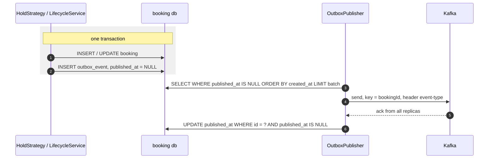

# Reliability

Each mechanism below exists because of one specific failure. The failure is named first; the
mechanism follows. Nothing here needs distributed transactions — every guarantee is a unique
constraint, a conditional `UPDATE`, or a sweep that finishes what a crash interrupted.

| Failure | Defence | Where |
| --- | --- | --- |
| A client retries a hold it never got an answer to, and gets a second booking | hold idempotency on `(guest_id, idempotency_key)` plus a stored request hash | `booking-service/src/main/java/dev/roomlock/booking/hold/HoldService.java`, `booking-service/src/main/resources/db/migration/V2__create_booking.sql` |
| A client reuses one key for a different request | the request hash refuses it with 409 instead of replaying a wrong answer | `booking-service/src/main/java/dev/roomlock/booking/hold/RequestHash.java` |
| The booking commits and the event is lost, or the event goes out and the booking rolls back | transactional outbox: the event is written in the booking's transaction | `booking-service/src/main/java/dev/roomlock/booking/outbox/OutboxWriter.java`, `booking-service/src/main/resources/db/migration/V3__create_outbox_event.sql` |
| The process dies between publishing an event and marking it published | send first, mark second — the event is sent again rather than lost | `booking-service/src/main/java/dev/roomlock/booking/outbox/OutboxPublisher.java` |
| Kafka redelivers an event and the guest is told twice | `notification.event_id` unique, claimed before the send | `notification-service/src/main/java/dev/roomlock/notification/notify/NotificationService.java`, `notification-service/src/main/resources/db/migration/V1__create_notification.sql` |
| Kafka redelivers a refund, or the booking service retries `Charge`, and the guest is charged twice | booking id is the idempotency key of both `Charge` and `Refund` | `payment-service/src/main/java/dev/roomlock/payment/payments/PaymentService.java`, `payment-service/src/main/resources/db/migration/V1__create_payment.sql` |
| A hold is abandoned and its room is blocked forever | the hold expiry sweep | `booking-service/src/main/java/dev/roomlock/booking/lifecycle/LifecycleService.java` |
| A `PAYING` booking is left behind by a call that never came back | the reconciliation sweep asks `Charge` again, which is idempotent on the booking id | `booking-service/src/main/java/dev/roomlock/booking/payment/PaymentReconciler.java` |
| A record the consumer can never handle blocks its partition | retry with backoff, then the dead-letter topic; unreadable records skip the retries | `payment-service/src/main/java/dev/roomlock/payment/infra/KafkaConsumerConfig.java`, `notification-service/src/main/java/dev/roomlock/notification/infra/KafkaConsumerConfig.java` |

## Idempotent holds

**The failure.** `POST /api/v1/bookings` creates a booking. A client whose connection drops after the
request reached the server has no way to tell a lost request from a lost response. If it retries, it
must not end up with two bookings — and it must not be told 409 `room-busy` because it is competing
with itself.

**The mechanism.** The client sends an `Idempotency-Key` header (required, non-blank, at most 64
characters, enforced on the controller parameter). Three things use it:

1. `booking_guest_id_idempotency_key_key UNIQUE (guest_id, idempotency_key)`. The key is scoped to
   the guest, so two guests may independently pick the same string. This is the only actual guarantee
   (rule I-1); everything else is an optimisation or a better error message.
2. `request_hash char(64)` — the SHA-256 of `roomId|guestId|checkIn|checkOut` as 64 hex characters
   (`hold/RequestHash.java`). Stored with the booking.
3. `HoldService.hold` looks the key up before it calls a strategy at all, and compares hashes.

What a reused key answers (`HoldService.replayOf`):

| The key exists and the hash | Result | HTTP |
| --- | --- | --- |
| matches | `AlreadyHeld` with the booking the first call created | 200, same booking id, no second row |
| differs | `IdempotencyKeyReused` | 409 `urn:roomlock:problem:idempotency-key-reused` |

The second row is rule I-2, and it is the reason the hash is stored at all. Replaying the first
answer to a *different* request would quietly tell a client that a stay it never asked for is held;
refusing it surfaces the client's bug instead.

**The race.** The pre-check is not the guarantee: two retries can arrive at once and both find no
previous booking. Then both reach the strategy, one inserts, and the other hits `23505` on the unique
constraint, which `TransactionalHoldStrategy` translates to `HoldOutcome.KeyTaken`. `HoldService`
handles that by reading the key again (`replayOfRace`) and running the same hash comparison — so the
loser of the race gets 200 with the winner's booking, exactly as if it had arrived second. If the
lookup finds nothing at all, which would mean the row was inserted and then removed, the service logs
a warning and answers `RoomContended`, inviting a retry rather than inventing an answer. Under the
`constraint` strategy this path is not guaranteed; see
[known gaps](#known-gaps).

**The pre-check is also what makes a sequential retry read as a replay rather than a conflict.**
`HoldService.hold` looks the key up before `strategies.active()` is called at all. Without that, a
retry arriving after the first booking committed would be handed to a strategy, and the strategy would
see the first booking overlapping the requested stay — `PESSIMISTIC` and `OPTIMISTIC` would answer
`Busy`, `CONSTRAINT` would hit a constraint — so the client would be told 409 about its own booking
instead of being handed it.

`IdempotentRetrySimulation` in the load tests asserts this end to end: the same hold twice with one
key, and the second answer must be 200 with the first booking's id.

## The transactional outbox

**The failure.** booking-service has to change a row *and* tell the world. Doing both means writing to
two systems. Whichever order you choose, a crash in the middle leaves them disagreeing: an event about
a booking that rolled back, or a committed booking nobody hears about.

**The mechanism.** The event is written to `outbox_event` in the *same database transaction* as the
booking change, and a separate sweep publishes it afterwards.



Three design decisions, each with its own reason.

### The event is written inside the booking's transaction

`OutboxWriter.append` and every method of `BookingOutbox` are annotated
`@Transactional(propagation = Propagation.MANDATORY)`. `MANDATORY` throws if there is no transaction
in progress, so the code *cannot* be called outside one. The javadoc of `OutboxWriter` states the
reason: "an event written in a transaction of its own could survive a booking that rolled back, which
is exactly what an outbox exists to prevent." This is rule K-1.

It composes with the hold strategies naturally: each strategy calls `outbox.recordHeld(booking)` right
after `saveAndFlush`, inside the attempt's own transaction, so a rolled-back attempt takes its event
with it. `LifecycleService.expireHolds` does the same for a whole batch — the `RETURNING` of
`expireHolds` hands back exactly the ids that were cancelled, and one event per id is written beside
them in the same transaction, which is also why the sweep is batched: the transaction stays as short
as the batch rather than as long as the backlog.

### The publisher sends before it marks

`OutboxPublisher.publish` sends, then marks. The javadoc says why: "a crash between the two sends the
event again, and a duplicate is a consumer's business (every event carries an id for exactly that).
The other order could lose an event, which no consumer can repair."

That is at-least-once by construction, and it is only acceptable because both consumers deduplicate on
`eventId` (rule K-3). The mark itself is conditional —
`OutboxEventRepository.markPublished` is `UPDATE ... WHERE id = ? AND published_at IS NULL` — so of two
publishers that sent the same event only one marks it, and the other learns from the affected-row count
that it was a duplicate and logs it at INFO ("was published twice"). Rule DB-5 again: `published_at`
and `attempts` are declared `updatable = false` on the entity and only ever move through native
statements.

`KafkaEventSender` makes "sent" mean something: `spring.kafka.producer.acks: all` and
`kafka.send(record).get(30, SECONDS)`. The row may only be marked once every replica has the record,
and a timeout or an interrupt becomes `EventSendFailedException` so the row stays for the next sweep.
The record carries `bookingId` as the key — so all events of one booking share a partition and keep
their order — and the event type in the `event-type` header. `KafkaEventSender.topicOf` maps the four
contract types onto the two topics and throws for anything unknown, so a new contract record cannot be
published to nowhere.

### A refused event stops the sweep

```java
for (OutboxEvent event : pending) {
  if (!publish(event)) {
    break;
  }
  published++;
}
```

`publishBatch` reads the batch oldest-first (`ORDER BY created_at`, driven by the partial index
`outbox_event_unpublished_idx ON outbox_event (created_at) WHERE published_at IS NULL`) and stops at
the first event the broker refuses, rather than skipping it. The reason is ordering: the events of one
booking are published in the order they were written, and continuing past a refusal would publish a
`BookingCancelled` before the `BookingHeld` it follows. A consumer that sees a cancellation for a
booking it never heard of has no way to recover the lost order.

A refusal also bumps `attempts` (`recordAttempt`) and increments `roomlock.outbox.failures`, so a stuck
event can be told from a fresh one.

**Observability.** `OutboxMetrics` publishes `roomlock.outbox.published` and
`roomlock.outbox.failures` as counters and `roomlock.outbox.unpublished` as a gauge over
`countByPublishedAtIsNull()` — the backlog, which a dashboard watches instead of guessing the lag. The
Grafana dashboard has an "Outbox" row with the backlog and the published/failed rates.

## Idempotent consumers

Kafka is at-least-once and the outbox deliberately makes it so. Both consumers therefore treat a
redelivery as normal traffic, and both do it with a database constraint rather than with offsets. Both
services set `enable-auto-commit: false`, `listener.ack-mode: record` (commit after the handler
returned, per record) and `auto-offset-reset: earliest`, with the same comment in both
`application.yml` files: a new deployment reads the whole topic on purpose, because the table — not
the offset — is what prevents a duplicate effect.

### notification-service: one delivery per event

`notification.event_id` is `UNIQUE`. `NotificationService.notifyGuest`, inside one transaction:

1. `messages.render(event)` — `RefundRequested` renders to empty and the method returns; no row, no
   delivery.
2. `existsByEventId(eventId)` — the fast path for a redelivery, logged and skipped.
3. `saveAndFlush(Notification.claim(...))` — the claim is written **and flushed** before anything is
   sent, so the unique constraint rejects a concurrent duplicate at this point rather than after the
   guest has been told.
4. `sender.send(message)` — the port. If it throws, the transaction rolls back with the claim, the
   event counts as unhandled, and its redelivery notifies the guest for real.
5. `claim.markSent(now)` — flushed at commit.

The invariant the entity javadoc states: a `notification` row without `sent_at` never committed. That
is only true because the send happens inside the transaction, which is a deliberate trade — see
[known gaps](#known-gaps).

### payment-service: one refund per booking

`RefundRequestsListener` reads the record, then calls the same `PaymentService.refund` the gRPC
`Refund` call goes through. It catches nothing on purpose: a failure belongs to the container's error
handler. Deduplication is not by event id here but by effect — the refund is keyed by booking id and
conditional on the payment still being `APPROVED`, so a redelivery simply finds nothing to change and
answers `AlreadyRefunded`.

`RefundEventReader` is stricter than notification-service's reader: the refund requests topic carries
exactly one type of the contract (rule K-2), so anything else on it — even another valid booking event
— is an `UnreadableEventException` and gets parked rather than ignored, because "a refund that ends up
as the wrong type is worth looking at".

### What happens to a record that cannot be handled

Both services build one `DefaultErrorHandler` bean, which is all the wiring the auto-configured
listener container factory needs:

- `FixedBackOff(backoff, attempts)` from configuration — 2 retries, 1s apart, and `0s` under the
  `test` profile so tests do not wait (rule T-7).
- `UnreadableEventException` is registered through `addNotRetryableExceptions`: an unknown
  `event-type`, a missing header or a payload that does not parse will fail identically forever, so it
  skips the retries entirely.
- Either way the record is logged at ERROR and published to `<topic>.DLT` by a
  `DeadLetterPublishingRecoverer`, with the partition left to the producer because the dead-letter
  topic may have fewer partitions. The consumer then moves to the next offset — one bad record never
  stops the consumer or blocks its partition.

The event type is read from a header rather than from the payload precisely so that this can work: an
unreadable record is an ordinary exception thrown by the listener, not a deserialization failure the
container has to be configured to survive.

## The idempotent charge and refund

**The failure.** `Charge` is a synchronous call that moves money. booking-service may retry it — after
a timeout, or from the PAYING sweep — and it cannot know whether the first call was executed. The
`RefundRequested` event may be redelivered for the same reason.

**The mechanism.** The booking id *is* the idempotency key, on both operations. There is no separate
key, no expiry, and nothing to clean up: `payment_booking_id_unique UNIQUE (booking_id)` allows one
payment row per booking, forever.

`PaymentService.charge`:

1. `findByBookingId` — if a payment exists, this is a repeat; go to the comparison below.
2. `rule.decide(command)` — `ChargeRule` is a pure function of the command and the configured
   `DecisionMode`, with no randomness, so the same charge always decides the same way. A declined
   charge is stored too, as a `DECLINED` row.
3. `insertIfBookingFree` — `INSERT ... ON CONFLICT (booking_id) DO NOTHING`. A read-then-write is
   avoided entirely (rule DB-5); `0` rows means another call decided first, and `replayOfRace` reads
   its payment and treats this call as the repeat it turned out to be.

What a repeat is answered with (`replayOf`, rule I-2):

| The stored payment vs. the new command | Result | gRPC |
| --- | --- | --- |
| same guest, amount and currency | `AlreadyCharged` with the stored payment | normal `ChargeResponse` — `APPROVED` or `DECLINED` with the stored `decline_reason` |
| a different guest, amount or currency | `Mismatched` with a `ChargeMismatch` | `FAILED_PRECONDITION`, refused |

The refusal is the important half. Replaying the stored decision for a command that is not the same
command would hide a caller bug — two different charges collapsing into one — and retrying cannot help,
so the call is rejected with a description naming what the booking was actually charged.

`PaymentService.refund` is the mirror image: `markRefunded` is
`UPDATE payment SET status = 'REFUNDED', refunded_at = ? WHERE booking_id = ? AND status = 'APPROVED'`,
so only one of two concurrent refunds — a retried gRPC call and a redelivered event arriving together —
can match. The affected-row count decides:

| Situation | Result | `RefundResponse.refunded` |
| --- | --- | --- |
| the update matched | `Refunded` | `true` |
| the row is already `REFUNDED` | `AlreadyRefunded` | `true` |
| the charge was `DECLINED` | `NotApproved` | `false` |
| no payment row at all | `NotCharged` | `false` |

The last two are business outcomes rather than errors on purpose: "both callers of the use case — the
gRPC client and the refund consumer — need a final answer, not something to retry forever." A consumer
that got an error status would retry a refund that can never succeed until the record is parked.

The schema enforces the same invariants the code assumes, so a bug cannot produce a half-state:
`payment_decline_reason_consistent` makes `DECLINED` the only status that carries a reason, and
`payment_refunded_at_consistent` makes `REFUNDED` the only one that carries `refunded_at`. The
`APPROVED` branch of `notRefundedNow` therefore throws `IllegalStateException` — the conditional
`UPDATE` matches every `APPROVED` row, so reading one back after a failed refund would mean the
database contradicts itself.

## Sweeps that clean up what a crash left behind

Neither the outbox nor a hold depends on the request that created it still being alive. Both are
finished by a scheduled sweep, and both sweeps are `@Profile("!test")` along with `SchedulingConfig`
itself, so under the `test` profile no `@Scheduled` task is registered at all and a test drives the use
case directly with a `MutableClock` (rules SP-9, T-7).

| Sweep | Interval / batch | What it repairs |
| --- | --- | --- |
| `OutboxScheduler` → `OutboxPublisher.publishBatch` | `roomlock.outbox.interval` = `PT1S`, `batch-size` 100 | every committed event that was not published yet — including events whose publishing attempt died mid-flight |
| `HoldExpiryScheduler` → `LifecycleService.expireHolds` | `roomlock.hold.expiry.interval` = `PT30S`, `batch-size` 500 | `HELD` bookings past `hold_expires_at` (`roomlock.hold.ttl` = 10m from creation), cancelled with `HOLD_EXPIRED` so the room is released |

Both intervals are ISO-8601 strings because `@Scheduled(fixedDelayString = ...)` reads the same
property the `@ConfigurationProperties` record binds as a `Duration`. Both are `fixedDelay`, counted
from the end of the previous sweep, so a slow sweep cannot overlap itself.

The hold expiry sweep is the guarantee behind the whole hold model: a client that starts a booking and
disappears costs the room for at most `roomlock.hold.ttl`. `FOR UPDATE SKIP LOCKED` inside its CTE
means a row another transaction is currently writing is passed over rather than waited on, and the
next sweep picks it up — so the sweep never blocks on, or fights with, a live request.

## The payment flow

The booking side of the payment flow is being implemented in parallel with this document and is **not
in `feat/booking-outbox`**. The reliability argument of the target flow, for reference:

- `POST /api/v1/bookings/{id}/pay` moves `HELD → PAYING` with a conditional `UPDATE`, then calls
  `Charge` over gRPC, then `PAYING → CONFIRMED` (writing `BookingConfirmed` to the outbox) or
  `PAYING → CANCELLED` with `PAYMENT_DECLINED` (writing `BookingCancelled`).
- A call that never came back leaves the booking in `PAYING`. A scheduled sweep asks `Charge` again,
  which is safe for exactly one reason: the booking id is the idempotency key, so the second call is
  answered with the first decision and no second charge happens. `booking.payment_started_at` and
  `booking_status_payment_started_at_idx` already exist in `db/migration/V2` for that sweep.
- Cancelling a `CONFIRMED` booking writes both `BookingCancelled` and `RefundRequested` in the
  cancellation's transaction; payment-service consumes `RefundRequested` and refunds idempotently.
  Today `LifecycleService.cancel` refuses a `CONFIRMED` booking with 409 `booking-not-cancellable`.

Everything the payment side of that story needs is already complete and tested in payment-service; see
[architecture](architecture.md#what-is-here-and-what-is-landing-next) for the full inventory.

## Known gaps

- **Under the `constraint` strategy, a *simultaneous* retry may be answered 409 `room-busy` instead of
  200.** Two identical in-flight requests both reach `ConstraintHoldStrategy`, and the loser's insert
  breaks two constraints at once: `booking_guest_id_idempotency_key_key` (the retry) and
  `booking_no_overlap` (the stay). Which one PostgreSQL reports depends on the order it maintains the
  two indexes in, and `TransactionalHoldStrategy.outcomeOf` checks `23P01` before `23505` — so a
  reported exclusion violation becomes `Busy` and never reaches the `KeyTaken` path that would read
  the winner's booking back. The sequential retry, which is the case a client actually hits after a
  timeout, is handled correctly by the pre-check.
- **The outbox publisher assumes a single instance.** Nothing elects a leader and the pending query
  takes no lock, so two booking-service replicas would both sweep and both publish the same events.
  `markPublished` detects it afterwards and logs "was published twice", and consumers deduplicate, so
  the system stays correct — but the duplication is by accident of the consumers, not by design.
  `expireHolds` is safe under replicas because of `FOR UPDATE SKIP LOCKED`; the outbox has no
  equivalent.
- **A refused event still holds up its own booking, for good.** A refusal now stops that booking
  alone, and an event refused `roomlock.outbox.stuck-after` times is logged as an error and counted by
  `roomlock.outbox.stuck` — but it is retried forever and no tool moves it aside. Dropping a committed
  event is worse than waiting, so the resolution is deliberately a human one; there is no
  poison-message path and no backoff between sweeps.
- **Published outbox rows are never deleted or archived.** `outbox_event` grows without bound, and
  `roomlock.outbox.unpublished` runs a `COUNT` on the table on every Prometheus scrape (5s).
- **notification-service calls the sender inside the database transaction.** That is what makes "a row
  without `sent_at` never committed" true and what makes a failed send roll the claim back, but it
  means a slow or hanging channel holds a Hikari connection for the duration. With the logging adapter
  this is free; with a real e-mail or SMS adapter it would need rethinking.
- **A concurrent duplicate delivery in payment-service is not recognised as one.** notification-service
  reads the unique violation of its claim as a redelivery (`NotificationDelivery` owns the transaction
  so the violation can be read after it rolled back); payment-service resolves its own race by reading
  the stored payment instead, which is correct, but a duplicate that loses the insert race on a
  *different* constraint would still surface as a listener failure.
- **Nothing consumes the dead-letter topics.** `<topic>.DLT` is created in tests and written to in
  production, but no service, tool or documented procedure reads them back.
- **Reconciliation only runs from booking-service outwards.** The sweep finds a booking stuck in
  `PAYING` and asks the provider again, so an answer that was lost is recovered. Nothing looks the
  other way: an `APPROVED` payment whose booking row went missing, or a `CONFIRMED` booking with no
  payment row, would not be detected.
